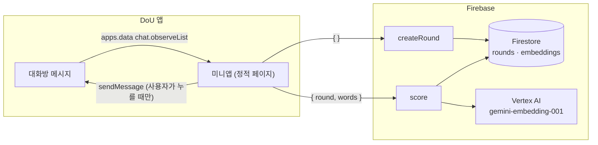

# 가까운 말

DoU 대화방에서 함께 푸는 단어 맞히기 미니앱입니다. 판마다 서버만 아는 숨은 단어가 있고, 대화방에 단어를 치면
숨은 단어와 뜻이 얼마나 가까운지 점수(0 ~ 100)가 순위표에 나옵니다. 숨은 단어를 그대로 치면 그 판이 끝납니다.

- 미니앱: Vite + TypeScript, [`@lemoncloud/chatic-apps-sdk`](https://www.npmjs.com/package/@lemoncloud/chatic-apps-sdk) 0.3.0
- 서버: Firebase Cloud Functions(`functions/`) + Firestore, 유사도는 Vertex AI Gemini 임베딩
- 계획 · 진행 상태: [MINIAPP.md](./MINIAPP.md)

## 구조



- 판 시작: "새 판" → `createRound`가 판 번호를 주고 → 미니앱이 대화방에 `🎯 가까운 말 #<번호> 시작`을 보냅니다.
  다른 사람의 미니앱은 이 메시지를 보고 같은 판에 들어옵니다.
- 시작 메시지에는 참여 링크가 붙습니다(`apps.link({ room })` → `https://app.chatic.io/apps/dou-closer-word?room=…`).
  링크로 열면 방 고르기를 건너뛰고 그 방의 순위표로 갑니다.
- 추측: 시작 메시지 뒤의 한 단어짜리 메시지(띄어쓰기 없는 한글 1 ~ 20자). 같은 단어는 처음 친 사람 것으로 칩니다.
  미니앱 입력칸으로 보내면 먼저 채점해서 `바다 · 41.20점 (17개 중 3위)`(정답이면 `바다 · 🎉 정답!`)으로 보내고, 이 꼴의
  메시지도 앞 단어를 추측으로 읽습니다. 메시지의 점수는 보기용이고 순위표는 늘 서버 점수를 씁니다. 이미 나온 단어는 보내지 않습니다.
- 새 판 규칙: 판이 진행 중이면 **시작한 사람, 방장·관리자**만 새 판을 열 수 있고, 10분 동안 추측이 없거나 정답이 나오면 누구나
  열 수 있습니다. 그 밖의 시작 메시지(버튼이든 손으로 친 것이든)는 무시하고 진행 상황 카드에 "무시했어요"로 보여 줍니다.
  모든 폰이 같은 메시지에 같은 규칙을 적용하므로 같은 판을 봅니다(`src/game.ts`).
- 판은 대화방에 묶입니다. 판을 만들 때 `SHA-256(<클라우드 id>:<대화방 id>)`를 서버에 같이 저장하고, 다른 대화방에서 온 채점은
  `WRONG_ROOM`으로 거절합니다. 서버는 해시만 비교하고 어느 방인지는 모릅니다. 거절된 판의 시작 메시지는 무시합니다.
- 진행 상황 카드: 진행 중 · 쉬는 중(10분 무응답) · 끝남, 시작한 사람과 시각, 참여 인원 · 추측 수 · 마지막 추측, 지금 가장 가까운 점수,
  내 추측과 최고 점수, 끝나면 정답과 맞힌 사람 · 걸린 시간, 무시한 새 판 시도.
- 서버로는 **판 번호, 대화방 해시, 단어만** 보냅니다. 이름 · 메시지 id · 사용자 id는 보내지 않습니다.
- 점수는 판마다 보정합니다. 단어 임베딩끼리의 코사인은 대개 0.75 ~ 0.85에 몰려 있어서, 숨은 단어와 단어 목록 평균의
  유사도를 0, 숨은 단어 자신을 100으로 둡니다. 평균보다 먼 단어는 음수가 나옵니다. 첫 판은 단어 목록 전체를 한 번 임베딩해서
  40초쯤 걸리고, 그 뒤로는 캐시를 씁니다.
- 판이 끝나면 정답과 가까운 단어 1 ~ 100위를 보여 줍니다(`similar`). 단어 풀은 공개 일상 명사 목록(`functions/vocab.json`,
  약 1,400개) + 숨은 단어 목록 + 지금까지 누군가 친 모든 단어이고, 판마다 한 번 계산해 판에 저장합니다. 정답 전에는 `NOT_SOLVED`로 거절합니다.
  처음 한 번은 어휘 전체를 임베딩하느라 2분쯤 걸렸고(2026-11-20 데움), 그 뒤로는 몇 초입니다.
- 숨은 단어 목록은 저장소에 없습니다. `functions/words.private.json`(JSON 배열, git 제외)에 두고 배포합니다.
  없으면 `functions/words.example.json`(예시 12개)을 씁니다.

## 로컬에서 돌리기

Node 22, Java(Firestore 에뮬레이터), Firebase CLI가 필요합니다.

```bash
npm install && npm --prefix functions install
```

```bash
npm run server
```

```bash
npm run dev
```

`npm run server`는 Functions(5101) · Firestore(8080) 에뮬레이터를 띄웁니다(`demo-closer-word`, 클라우드 계정 불필요).
에뮬레이터에서는 임베딩 대신 음절로 만든 가짜 벡터로 채점합니다(`functions/.env.local`). 뜻은 모르고 글자가 겹치면 점수가 오릅니다.
`npm run dev`의 주소(http://localhost:5180)를 브라우저로 열면 SDK의 mock이 앱 대신 답합니다. mock 대화방에서 "새 판"을 누르면
가상의 친구 둘이 단어를 몇 개 칩니다.

```bash
npm test && npm --prefix functions test
```

```bash
npm run build && npm run verify
```

## 배포

지금 배포된 곳: Firebase 프로젝트 `dou-closer-word`, 함수 리전 `asia-northeast3`
(`https://asia-northeast3-dou-closer-word.cloudfunctions.net/{createRound,score}`).

1. Firebase 프로젝트를 Blaze 요금제로 두고 Firestore · Vertex AI(Agent Platform, `aiplatform.googleapis.com`) API를 켭니다.
   Firestore 데이터베이스는 `asia-northeast3`에 만듭니다.
2. `.firebaserc`의 `default`를 그 프로젝트 id로 두고 `functions/words.private.json`을 만듭니다.
3. 배포합니다.

```bash
firebase deploy --only functions,firestore:rules
```

새 프로젝트의 첫 배포는 권한이 아직 퍼지지 않아 `serviceusage` 권한 오류로 실패할 수 있습니다. 그러면 반쯤 만들어진 함수를
지우고(`firebase functions:delete createRound score --region asia-northeast3`) 몇 분 뒤 다시 배포합니다.

4. `.env.production`에 서버 주소를 넣고 묶습니다.

```bash
echo "VITE_API_BASE=https://asia-northeast3-<project-id>.cloudfunctions.net" > .env.production
```

```bash
npm run build && npm run verify && npm run bundle
```

### 화면 올리기 (S3 + CloudFront)

dev 주소: **https://dou-closer-word.apps-dev.chatic.io/** · 운영 주소: **https://dou-closer-word.apps.chatic.io/**

`*.apps-dev.chatic.io`는 CloudFront 배포 하나가 모든 미니앱을 맡고, 호스트의 첫 라벨을 버킷 폴더로 바꿔 줍니다.
그래서 새 미니앱은 폴더 하나를 올리면 되고 CloudFront · 인증서 · DNS는 건드리지 않습니다.

```bash
cp .env.deploy.example .env.deploy
```

```bash
npm run bundle && DEPLOY_DRY_RUN=1 npm run deploy
```

```bash
npm run deploy
```

`npm run deploy`는 `dou-closer-word.zip`을 풀어 `DEPLOY_BUCKET`(`<버킷>/dou-closer-word`)에 올리고, 그 폴더만 CloudFront에서
무효화합니다. 버킷 이름과 배포 id는 `.env.deploy`(git 제외)에 둡니다. 운영(`*.apps.chatic.io`)은 같은 세 값과
`DEPLOY_HOST=apps.chatic.io`를 담은 `.env.deploy.prod`(git 제외)를 읽는 `npm run deploy:prod`로 올립니다.

서버는 `*.apps.chatic.io` · `*.apps-dev.chatic.io` · localhost에서 오는 요청만 CORS로 허용합니다. 폰에서 터널로 시험할 때는
`functions/.env`에 `EXTRA_ORIGINS=https://<터널 주소>`를 넣고 다시 배포합니다.

## 지금 되는 것과 안 되는 것

- 브라우저 mock + 에뮬레이터로 전체 흐름(판 시작 → 추측 → 채점 → 정답)은 됩니다.
- 대화방 읽기 · 보내기(`apps.data`)는 **검수된 주소**에서만 열립니다. DoU 제출 창구가 아직 없어서 폰에서는 아직 시험할 수 없습니다.
- 순위("상위 n위")와 판 포기는 다음 판에서 합니다.
